<p align="center">
  <picture>
    <source media="(prefers-color-scheme: dark)" srcset="docs/readme/patina-logo-dark.png">
    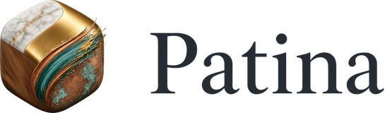
  </picture>
</p>

<h3 align="center">Post-process your models the way you would a photo.</h3>
<p align="center">Non-destructive, layered, and scriptable.</p>

<p align="center">
  <a href="https://github.com/storshun/Patina/releases/latest"></a>
  
  
  
</p>

<p align="center">
  <a href="https://github.com/storshun/Patina/releases/latest"><b>Download</b></a> ·
  <a href="#install">Install</a> ·
  <a href="#your-first-texture">Your first texture</a> ·
  <a href="#how-to">How-to</a> ·
  <a href="#whats-new">What's new</a> ·
  <a href="docs/FEATURES.md">Every feature</a>
</p>

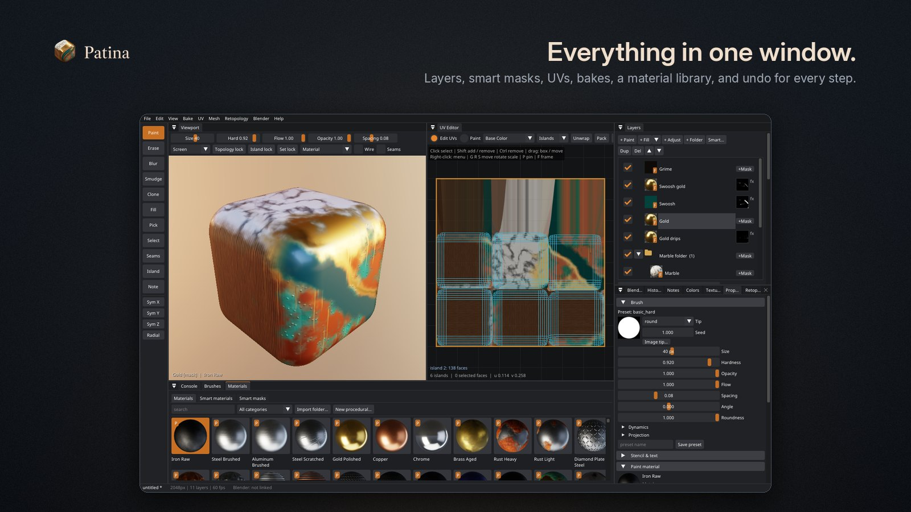

Patina is a desktop app for Linux and Windows that finishes 3D models. Paint materials straight onto a model, fix
its UVs, bake its maps, mend its mesh and export it ready for a game, a render or the web. It works hand in hand with
Blender, and any MCP agent can drive it.

## What it does

- **Paint materials, not colors.** One stroke lays down color, roughness, metal, height and normal at once, straight
  across UV seams. Pick from 270 materials made by 74 procedural generators and 22 smart materials, or use your own
  scans. Tablet pressure works on both systems.
- **Layers and smart masks.** Paint, fill and adjustment layers, folders and blend modes. Masks come from the shape of
  the model: worn edges, dirty cavities, dust on top. Every step can be undone, and the History panel jumps back to
  any of them.
- **UVs in the same window.** Paint over a part with the Island brush and press Enter: it becomes one clean UV island.
  Unwrap, pack, relax and edit seams. The paint you already have moves to the new layout.
- **Bakes.** Ambient occlusion, curvature and thickness are layers you can fix by hand. Bake from a high-poly, or
  paint the sculpt and bake every layer down onto its low-poly version.
- **Retopology.** Clean quads over a sculpt or a scan, steered by lines, zones, flow strokes and a density brush.
- **Scenes.** A character with its clothes, eyes and hair: each part is an object with its own layers.
- **Game-ready output.** Mesh Check finds and mends holes and flipped faces. Reduce polygons, make levels of detail,
  collision shapes and lightmap UVs. Export presets for Blender, glTF, Unreal and Unity.
- **Develop textures like photos.** Exposure, white balance, highlights and shadows on an adjustment layer, de-lighting
  for scans, and a check for colors no real material has.
- **Path traced renders** of your model and its textures, in the 3D view or as an image.
- **The Blender bridge.** Send a mesh from Blender, paint it, and the textures come back as a Principled BSDF material.
- **Patina Web.** A lighter version of the painter that runs in any browser, offline.
- **Automation.** An MCP server with nearly 200 commands, an HTTP API, and recipes that finish a whole folder of models.

<table>
  <tr>
    <td width="50%">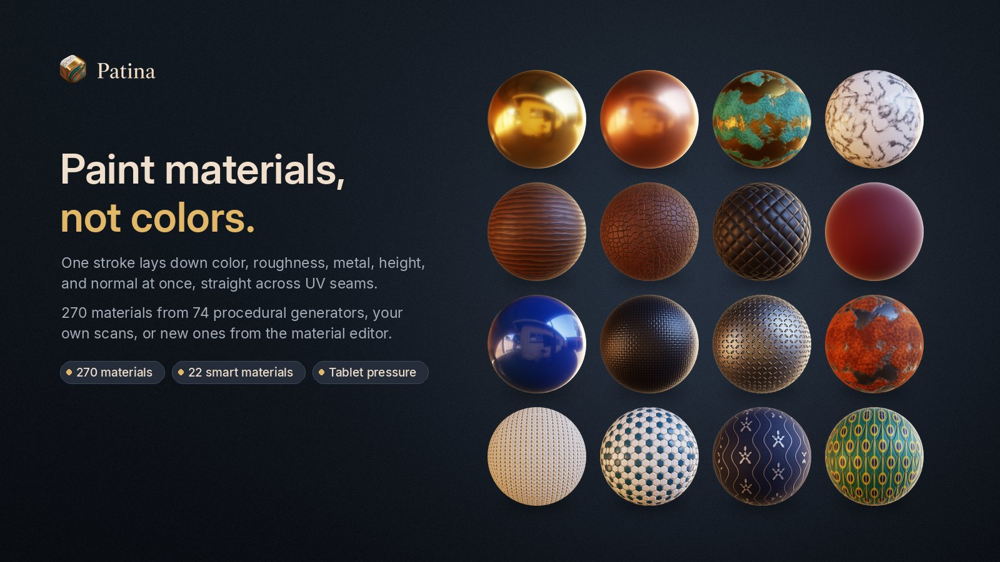</td>
    <td width="50%">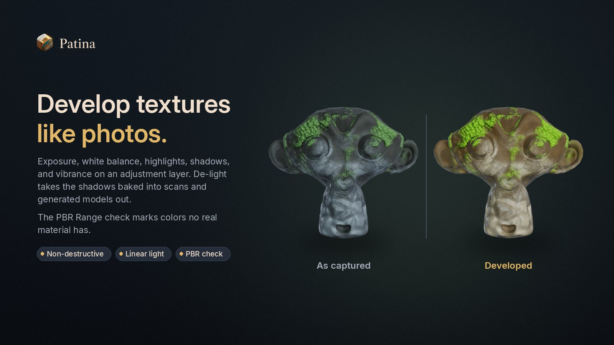</td>
  </tr>
</table>

## Download

Get the newest version from the [releases page](https://github.com/storshun/Patina/releases/latest).

| File | What it is |
|---|---|
| `patina-<version>-windows-x64.zip` | Patina for Windows 10 and 11 (x64) |
| `patina-<version>-linux-x86_64.tar.gz` | Patina for Linux (x86-64), built on Fedora 44 |
| `patina_bridge-<version>.zip` | The Blender add-on. It is also inside both downloads. |
| `patina-<version>-web-library.7z` | The newest material library for Patina Web |
| `patina-<version>-SHA256SUMS.txt` | Checksums of the files |

You need a graphics driver with **OpenGL 4.5**. Any NVIDIA, AMD or Intel GPU from about the last ten years has one.

## Install

### Windows 10 and 11

1. Unzip `patina-<version>-windows-x64.zip` anywhere, for example in your Downloads folder.
2. Right-click `install.ps1` and choose **Run with PowerShell**. It copies Patina to
   `%LOCALAPPDATA%\Programs\Patina` and adds a Start menu entry. It needs no administrator rights.
3. Start **Patina** from the Start menu.

You can also run `patina.exe` straight from the unzipped folder. The folder is portable.

- **"Windows protected your PC":** the download is not code-signed. Click **More info › Run anyway**.
- **PowerShell refuses the script:** run `powershell -ExecutionPolicy Bypass -File install.ps1`.
- **Remote Desktop and virtual machines** often offer only OpenGL 1.1, and Patina can't start there. Run it on the
  machine itself.

### Linux

```sh
tar xf patina-*-linux-x86_64.tar.gz
cd patina-*-linux-x86_64
./install.sh                  # installs to ~/.local, no root needed
# PREFIX=/opt/patina ./install.sh   to put it somewhere else
# ./install.sh --uninstall          to remove it again
```

Then start **Patina** from your application menu, or run `patina`. You can also run `./bin/patina` in place.

The prebuilt download needs glibc 2.43 or newer and SDL 3, as on Fedora 44. `install.sh` checks both and names
what is missing:

```sh
sudo dnf install SDL3 mesa-dri-drivers libglvnd-egl libglvnd-glx libX11 libXi zenity
```

On an older system or another distribution, [build Patina from source](#build-from-source). It takes a few minutes.
The prebuilt binary uses X11, so on a Wayland desktop it runs through XWayland. A build from source supports Wayland
directly.

### The Blender add-on

The add-on is `patina_bridge.zip`, next to the installer in both downloads.

- **Blender 4.2 and newer:** *Edit › Preferences › Get Extensions*, then the **⌄** menu at the top right, then
  **Install from Disk…**, and pick the zip.
- **Blender 3.6 to 4.1:** *Edit › Preferences › Add-ons › Install…*, pick the zip, and enable
  **Import-Export: Patina Bridge**.

Then open the **Patina** tab in the 3D view's sidebar (press **N**).

## Your first texture

A new Patina opens in the **Guided layout**. It splits the work into five steps along the top, each in its own
color: **Model, UVs, Bake, Paint** and **Export**. The button at the bottom of each step leads to the next one.

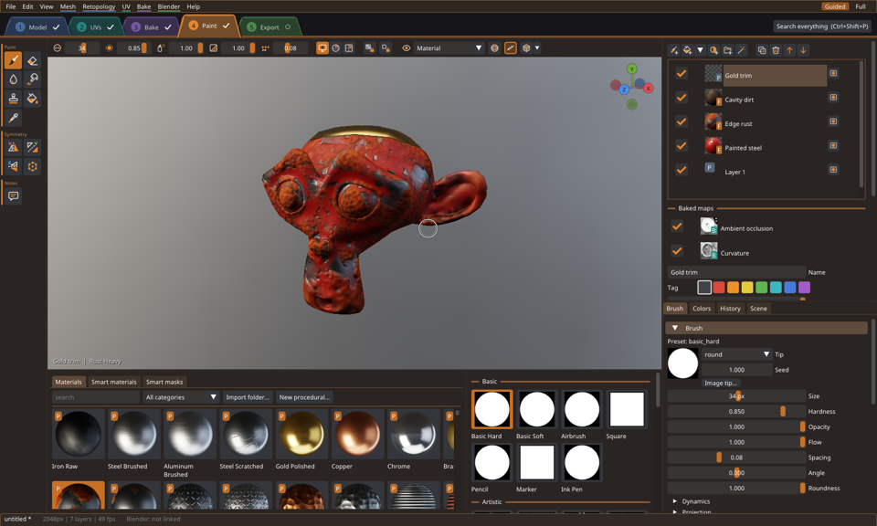

1. **Model.** Open your model (glTF, GLB, FBX, OBJ, STL, 3MF or PLY), or try the sample Suzanne. You can also drop a
   file on the window. The step shows what the mesh check found, and **Fix everything that can be fixed** mends it.
2. **UVs.** Patina paints across the surface, so most models paint well whatever their UVs. The step marks what the
   exported textures need fixed, such as overlapping islands, and fixes it in one click.
3. **Bake.** Bake the mesh maps. Smart masks use them to find edges and cavities.
4. **Paint.** Pick a material and paint, or drop a smart material on the model. Add a fill layer and give it a smart
   mask for worn edges or dirt.
5. **Export.** Pick a preset (Blender, glTF, Unreal or Unity) and a folder. The step lists every file it writes.

**Full** at the right of the menu bar shows every panel at once. Both layouts work on the same project, so you can
switch at any time. Press **F1** for the keys, and open the manual with *Help › Manual*.

## How-to

### Paint a model from Blender and get the textures back

1. Install the add-on (above). In the **Patina** tab, click **Launch Patina**.
2. Select your mesh and click **Send to Patina**. Several selected meshes go as a scene, each where Blender has it.
3. Paint in Patina. Press **Ctrl+B** (or click **Pull Textures** in Blender) to bring the textures back.

The textures arrive in a Principled BSDF material, and UVs you edited in Patina come back too. Keep modeling after you
paint: **Update Mesh** keeps the layers, even when the topology changed. *Auto-send after changes* keeps Blender up to
date while you paint.

### Dress a character: body, clothes, eyes and hair

- **File › Add a Model to the Scene** (Ctrl+Shift+I) adds a model as an object of its own. A file with several meshes
  opens as one object each.
- The **Objects** list at the top of the Layers panel shows them. Click an object to paint it. The layers below it,
  the UV editor and the bakes are that object's.
- **Double-click** another object in the 3D view to paint it instead. **/** shows only the object you paint.
- The **Object tool (W)** moves, turns and scales objects. *Export Model* writes the whole scene into one file.

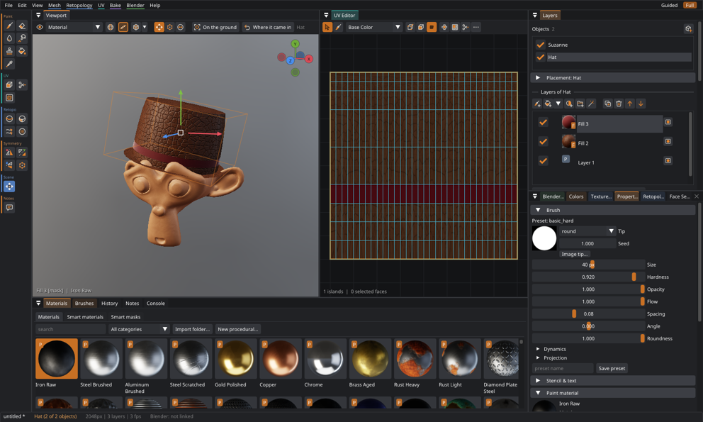

### Paint the sculpt, then bake it down to the low-poly

1. Open the high-poly model and paint it, where the detail is.
2. Make a low-poly with Patina's retopology (the **Retopo** tools on the left), or bring your own.
3. **Bake › Bake Down to a Low-Poly Model…** moves every layer onto the low-poly. The high-poly's shape goes into the
   normal map and the ambient occlusion.
4. The **Bake-Down Check** view marks the places worth a second look.

### Use your own brushes and materials

- **Brushes:** put images (PNG, JPEG, TGA, BMP, GIF, PSD or EXR) or Photoshop `.abr` files in your brushes folder.
  Each folder inside it becomes a group in the Brushes panel. New files show up by themselves within a few seconds.
  **Import brushes…** on the Brushes panel copies files there for you.
- **Scanned materials:** *File › Import Material Folder…*, or drop a folder on the window. Patina knows the file names
  of ambientCG, Poly Haven, Quixel and Substance exports.

| | Linux | Windows |
|---|---|---|
| Your materials and brushes | `~/.local/share/patina/user` | `%LOCALAPPDATA%\Patina\user` |
| Settings and window layout | `~/.config/patina` | `%APPDATA%\Patina` |
| Autosaves and the Blender exchange | `~/.cache/patina` | `%LOCALAPPDATA%\Patina\cache` |

### Make a model game-ready

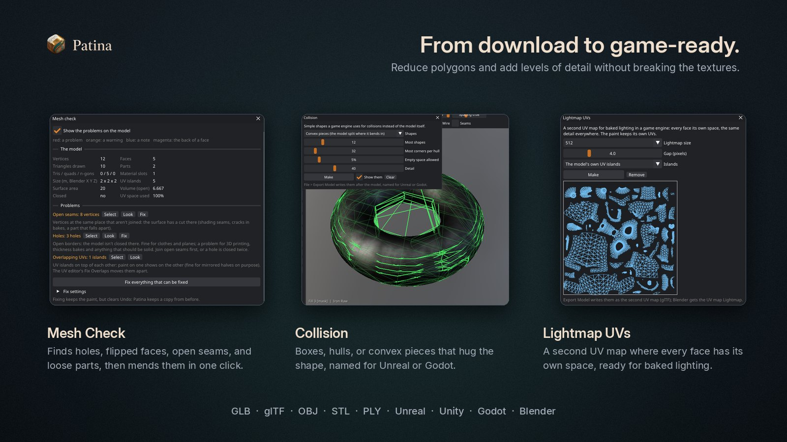

- **Mesh › Check Mesh…** finds holes, flipped faces, open seams and loose parts, then mends them in one click.
- **Mesh › Reduce Polygons…** lowers the triangle count without breaking the textures, and makes levels of detail.
- **Mesh › Collision…** and **Mesh › Lightmap UVs…** make collision shapes and a second UV map for baked lighting.
- **File › Export Textures…** (Ctrl+E) has presets for Blender, glTF, Unreal (ORM, DirectX normal) and Unity (mask map).
- **File › Batch Process…** runs a recipe on a whole folder of models in the background: mend, reduce, texture and
  export. The originals are never changed.

### Use Patina Web

Open it with *Help › Patina Web*, or open `web/index.html` from the download (on Linux after `install.sh`:
`~/.local/share/patina/web/index.html`). It needs no server and no internet connection. To put it online, copy the
`web` folder to any static web host.

To get the newest material library, extract `patina-<version>-web-library.7z` into the folder that holds Patina's
`web` folder, over the old one.

### Let an AI agent drive Patina

Patina is MCP ready. An agent can open models, paint, bake, fix UVs, render and export, in the window you are watching
or in a hidden Patina.

```sh
# Claude Code on Linux
claude mcp add patina -- ~/.local/bin/patina --mcp
# Claude Code on Windows (PowerShell)
claude mcp add patina -- "$env:LOCALAPPDATA\Programs\Patina\patina-cli.exe" --mcp
# the Claude desktop app (then restart it; on Windows: patina-cli.exe --setup-claude)
patina --setup-claude
```

Other MCP clients take the same command in their JSON configuration:

```json
{ "mcpServers": { "patina": { "command": "/home/you/.local/bin/patina", "args": ["--mcp"] } } }
```

The same commands work as JSON lines on `127.0.0.1:7860`, in the in-app Console, and over HTTP
(`patina --headless --http`). [docs/COMMANDS.md](docs/COMMANDS.md) lists all of them.

```
patina [model or project]             # open a model (.glb .gltf .fbx .obj .stl .3mf .ply) or a .patina project
patina --headless [--port 7860]       # the command server, no window
patina --mcp                          # MCP over standard input and output
patina run job.json --set name=value  # run a job file, then exit
patina call get_state                 # one command
```

On Windows, use `patina-cli.exe` for these. It is the same program as a console app.

## Gallery

<table>
  <tr>
    <td width="33%">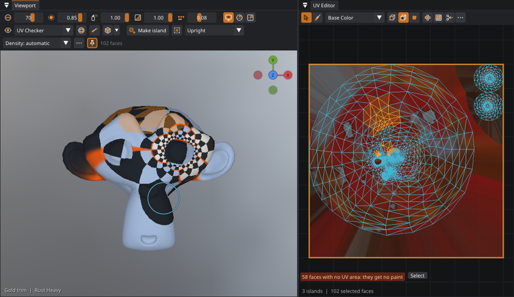<br><sub><b>The Island brush.</b> Paint a part, press Enter, and it is one UV island.</sub></td>
    <td width="33%">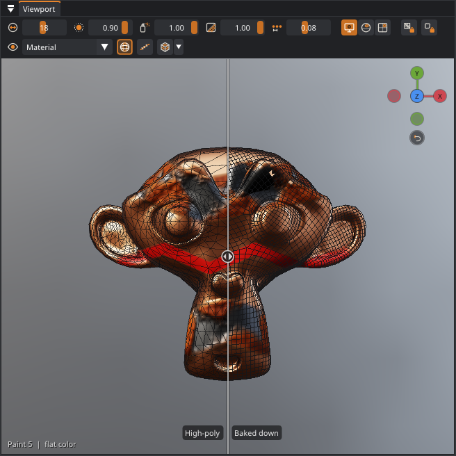<br><sub><b>Bake down.</b> The painted high-poly and the low-poly it was baked onto.</sub></td>
    <td width="33%">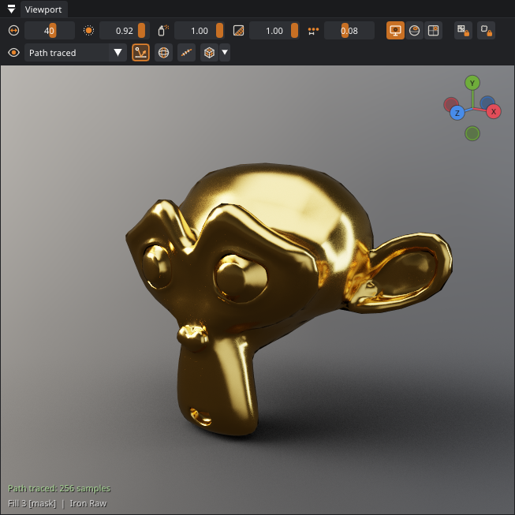<br><sub><b>Path traced view.</b> Polished gold, with real reflections.</sub></td>
  </tr>
  <tr>
    <td>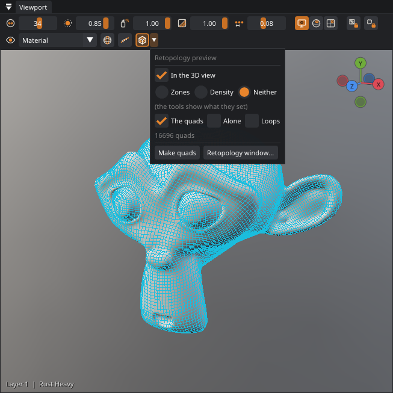<br><sub><b>Retopology.</b> A preview of the quads before you make them.</sub></td>
    <td>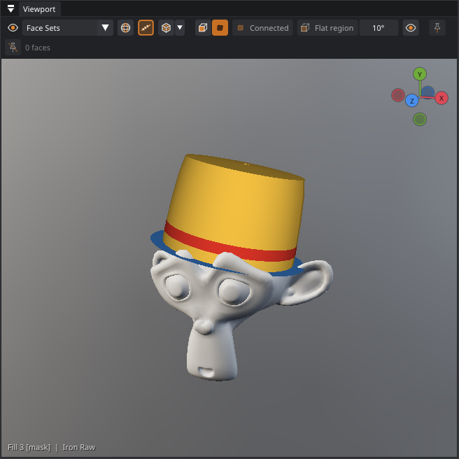<br><sub><b>Face sets.</b> Named groups of faces to hide, fill, mask or paint inside.</sub></td>
    <td>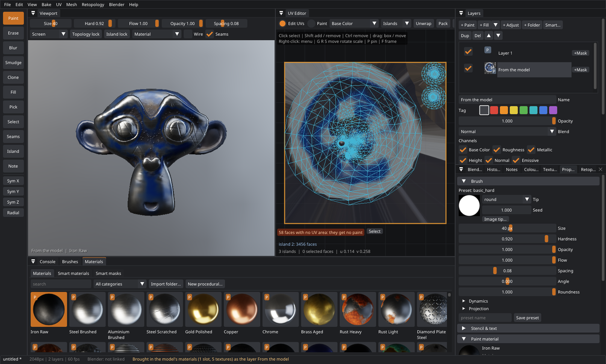<br><sub><b>Textures from the model.</b> A model opens with the textures it came with, as a layer.</sub></td>
  </tr>
  <tr>
    <td>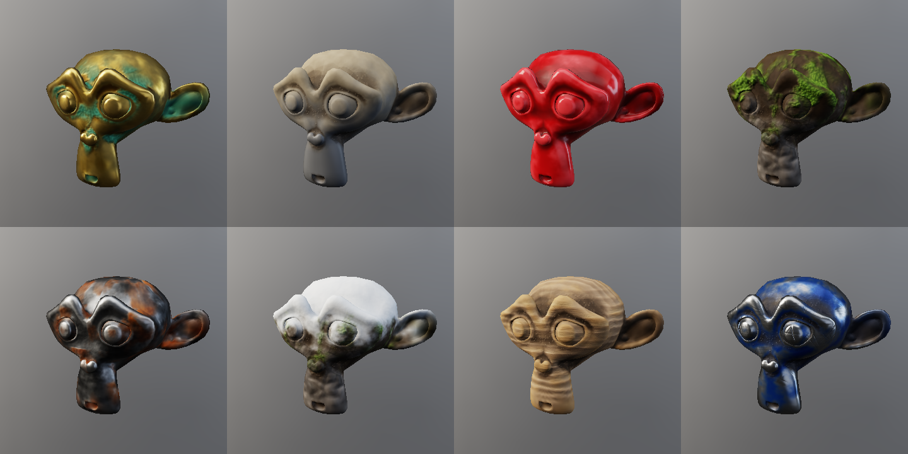<br><sub><b>Smart materials.</b> Rust, moss, worn paint and more in one drop.</sub></td>
    <td>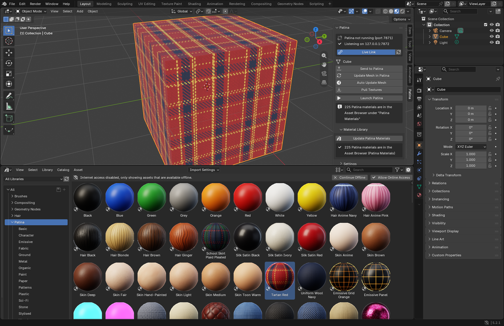<br><sub><b>In Blender.</b> The material library in Blender's Asset Browser.</sub></td>
    <td>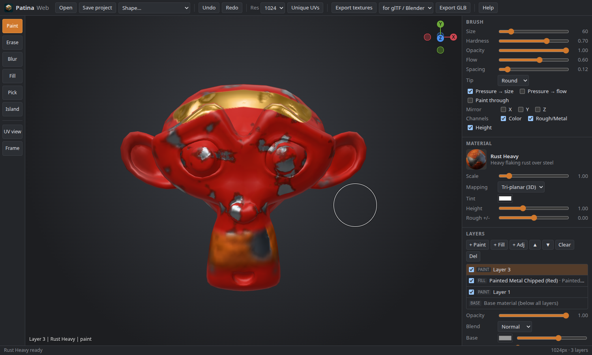<br><sub><b>Patina Web.</b> The painter in a browser, offline.</sub></td>
  </tr>
</table>

## What's new

The full list of changes is in [CHANGELOG.md](CHANGELOG.md), and *Help › What's New* shows it in the app.

<!-- changelog: filled from CHANGELOG.md by scripts/readme_changelog.py -->
### 1.2.2 (2026-10-22)

#### Fixed

- **Hair cards, leaves and lace from OBJ and FBX files came in solid.** Many game assets keep their cut-outs only in
  the color texture's alpha, and their file says nothing about opacity. Patina now makes that alpha the Opacity
  channel of the layer *From the model* when it has see-through and solid parts, and the status line says so. An
  alpha that is even all over is left out, because some assets keep gloss there. For a model you already brought in,
  select it and use *File › Bring In the Model's Textures* again.
- **See-through parts drew in the wrong order.** Back layers of hair cards could land on top of front ones, and an
  object that was not the one you paint lost its see-through parts in front of the one you do. Every object's opaque
  parts are drawn first now, then the see-through parts, and the nearest layer of cards hides the ones behind it.

#### Changed

- The layer's *Opacity* channel box and its *Channel opacity › Opacity* slider explain themselves: the see-through
  channel and its strength, not the slider that says how strongly the whole layer shows.
- `import_model_textures` takes `color_alpha`: `"opacity"` always uses the color texture's alpha, `"ignore"` never.

<details>
<summary><b>1.2.1 (2026-10-22)</b></summary>

#### Fixed

- **Saving could close Patina.** A paint layer with clearcoat (painted with car paint, lacquer or another material
  that has it) made every save and every autosave stop the app.
- **Paint in the opacity, sheen and subsurface channels was lost on saving.** Since 0.26, a save wrote those channels
  of paint layers as empty images, so they were gone when the project was opened again ("could not restore channel
  sheen"). They are saved now. Paint saved that way before 1.2.1 can't come back; fill layers keep theirs, because
  they come from their material.
- A save that fails says why instead of closing Patina, and the autosave tries again later.

#### Changed

- Patina Web's material library is baked again with every build. 1.2.0's downloads had the library of 0.26, with its
  British names; 1.2.1's has the current one.
- The Linux download's `INSTALL.txt` names what the build needs: its glibc version and SDL 3. `install.sh` checks for
  SDL 3, and says so when the system's glibc is too old for the build.
- The install notes and the manual no longer name version 0.2.0 in their file names.
- A new README: download, install, your first texture, how-tos, and this change log from 1.0.0 on. The list of every
  feature moved to `docs/FEATURES.md`.

</details>

<details>
<summary><b>1.2.0 (2026-10-21)</b></summary>

#### New

- **Objects in a scene.** A project can hold several models, each an object with its own layers, texture set and
  undo history: a body, its clothes, its eyes, its hair. The **Objects** list over the layers shows them. Click one
  to paint it, and the layers below, the UV editor and the bakes are that object's.
- **File › Add a Model to the Scene** (Ctrl+Shift+I) adds a model file as an object of its own, where the file
  puts it. Its texture set gets as many texels per meter as the object already open, so small parts like eyes get
  smaller textures.
- **Files with several meshes** (glTF, FBX, OBJ) open as an object each. Files with more than 24 meshes (kits of
  many small parts) still open as one. The MCP command `open_mesh` takes `separate` to choose.
- **The Object tool** (W) moves, turns and scales objects with a gizmo in the 3D view. Arrows move along an axis,
  rings turn, handles scale, and Ctrl snaps. Press W again for the next of the three. Each drag is one undo step in
  that object's history. A click on another object picks it. *On the ground* and *Where it came in* are on the
  tool's bar.
- **Double-click another object** in the 3D view to paint it. A brush stroke that starts on another object does
  nothing and says which object it is. Objects in front of the one you paint hide it from the brush.
- **Local view** (/) shows only the object you paint. Each object can also be hidden from its row in the list.
- **The object's placement** (location, rotation, scale) can be typed in under the Objects list. Right-click a
  row to rename, copy, remove, frame or hide an object.
- **Blender: several objects at once.** With add-on 0.14, *Send to Patina* sends every selected mesh. The active
  one starts the scene and the others come in beside it. *Add to the Patina Scene* adds them to what is open.
  Objects come in where Blender has them (their `matrix_world`). Updates go to their own object, and *Send
  Textures to Blender* sends every linked object's textures.
- **Exports of the whole scene.** *Export Model* writes every object shown into one file. glTF gets a node per
  object, where it is. OBJ, STL and PLY get the objects' vertices moved into the scene. *Export Textures* can
  write every object's maps, each set named after its object.
- **The path tracer renders every object**, with each one's own textures, in the Path traced view and in renders.
- **Select faces in batches** with the Select tool, in the 3D view and the UV editor:
  - **Alt+click** by an edge selects the loop of quads across it (Blender's face loop).
  - **Ctrl+Alt+click** selects the ring along it. Shift adds to the selection.
  - **Connected** grows the selection to the whole connected parts.
  - **Flat region** grows it over the surface where it bends less than an angle you set.
  - Right-click › **Select** offers all of these, plus the UV island and the material slot, from the face under
    the pointer.
- **Face sets**: named, colored groups of faces, kept in the project, like Blender's sculpt face sets. The **Face
  Sets** panel (UV › Face Sets) has them:
  - **New from the selection**, or a set for each material slot, UV island or connected part.
  - **Click** a set to select its faces. The **eye** hides them from the 3D view, the brush and picking (renders and
    exports keep them).
  - Right-click a set to **show it alone**, **fill** it with the paint material, or **mask** the selected layer
    with it.
  - The **Face set lock** keeps a stroke inside the set it starts on. The **Face Sets** view shows each set in its
    color, on the model and on the UV layout.
  - Face sets follow their faces through a bake-down, a reduction and a remodeled mesh. Blender's sculpt face sets
    come in with the model (add-on 0.14).
- **Your own brushes.** Every image in your brushes folder becomes a brush: PNG, JPEG, TGA, BMP, GIF, PSD or EXR.
  Each folder inside it is a group in the Brushes panel, at the top. Photoshop brush files (`.abr`) there give a brush for each
  of their tips. Patina looks at the folder every few seconds, so a file you add shows up by itself.
  - **Import brushes...** on the Brushes panel, or a drop on it, copies files into the folder.
  - Tips are read the right way round: a dark shape on a light ground paints with the shape, as Photoshop, GIMP and
    Krita tips are made. So do a light shape on a dark ground and an image with transparency.
- **MCP:** `list_objects`, `add_object`, `select_object`, `set_object`, `remove_object`, `duplicate_object`,
  `isolate_object`, `frame_object`, `pick_object`, `select_loop`, `select_linked`, `list_face_sets`,
  `make_face_set`, `edit_face_set`, `delete_face_set`, `use_face_set`, `reload_brushes`, `import_brushes`.
  `export_model` and `export_textures` take `objects`, `send_to_blender` takes `objects`, and `set_brush` takes
  `lock_face_set`. New feature switches: `scene_objects` and `face_sets`.

#### Changed

- A project with several objects is saved in one `.patina` file. Patina 1.1 and older open its first object only.
- A model dropped on the window while one is open asks whether to add it to the scene or open it instead. Drop it
  on the Objects list to add it right away.
- Objects you are not painting free their compositing memory until they are painted or exported again.
- The status bar names the object you paint when there are several.
- An image tip drawn small is smoother: its mip levels are made now.
- An image dropped on the Brushes panel becomes a brush of its own, kept in your brushes folder. It used to change
  only the current brush's tip.
- Help › What's New opens this list in the manual.

#### Blender add-on 0.14.0

- *Send to Patina* sends every selected mesh, and the new *Add to the Patina Scene* adds them beside what Patina
  has.
- Each object's placement goes along. The automatic mesh sync only updates objects Patina's scene has.
- The sculpt face sets go along, for Patina's face sets.

</details>

<details>
<summary><b>1.1.0 (2026-10-21)</b></summary>

#### New

- **Bake down from the high-poly.** Paint the sculpt, then bake every layer down onto its low-poly version, with
  *Bake › Bake Down to a Low-Poly Model* or *Use the Quads as the Model* after Patina's retopology. The low-poly
  becomes the model and the whole layer stack comes along.
  - Paint, masks and fixes are measured at up to 16 points per texel, each looking along the low-poly's normal for
    the high-poly's surface.
  - Painted normals are turned to fit the new surface. The high-poly's shape goes into the normal map and the
    ambient occlusion.
- **The Bake-Down Check view** marks where the transfer had to take the nearest point (amber) or guess (red), and
  where the low-poly faces away from the high-poly (magenta).
- **The compare view** can put the high-poly as it was beside the result.

#### Changed

- *Bake from a high-poly mesh* uses the same rays: 4 points per texel, with the distance measured from the two
  models.
- Retopology quads face outward when they are used as the model, sent to Blender or exported.

</details>

<details>
<summary><b>1.0.0 (2026-10-21)</b></summary>

The first stable release. It has the **Guided layout** for a first project (Model, UVs, Bake, Paint and Export, each
step in its own color) and the **Full layout** with every panel at once. Projects, presets, keys and layouts from the
0.x versions open as they were.

</details>
<!-- /changelog -->

## Build from source

Fedora:

```sh
./scripts/build-fedora.sh     # installs the build tools with dnf, builds, runs the tests, installs to ~/.local
```

By hand, on any Linux with CMake, Ninja, a C++20 compiler, SDL 3 and the OpenGL and EGL headers:

```sh
sudo dnf install gcc-c++ cmake ninja-build SDL3-devel mesa-libGL-devel mesa-libEGL-devel zenity
cmake -S . -B build -G Ninja -DCMAKE_BUILD_TYPE=Release
cmake --build build
./build/patina
```

Without an SDL 3 package, CMake downloads and builds SDL 3 itself. Every other library is in `third_party/`.

- **Tests:** `ctest --test-dir build` runs the core and GPU tests, which paint across seams and check undo, masks,
  UVs, projects and the Blender bridge. `scripts/run_gui_tests.py` runs the window tests on hidden displays.
- **Windows:** cross-compile it on Linux with [llvm-mingw](https://github.com/mstorsjo/llvm-mingw):
  `LLVM_MINGW=/opt/llvm-mingw scripts/build-windows.sh`.
- **Packages:** `scripts/package-release.sh build-release dist` makes the Linux download and the source tarball.
- **Patina Web:** `python3 scripts/build_web.py --patina build/patina` writes it to `web/dist/`.
- **The Blender add-on:** `blender/make_zip.sh` writes `blender/dist/patina_bridge.zip`.

<details>
<summary>Where things are in the source</summary>

```
src/core       the mesh, file formats, BVH, UV and selection algorithms, images
src/gfx        OpenGL wrappers
src/shaders    GLSL, embedded at build time
src/engine     texture sets, layers, the compositor, painter, materials, brushes,
               renderer, path tracer, undo, scenes, and the commands (the automation API)
src/platform   the headless EGL context, the TCP JSON-lines server and client
src/mcp        the MCP server
src/ui         the SDL 3 and Dear ImGui application
blender/       the Blender add-on (Python)
materials/     the built-in material library (JSON)
smart_materials/  the built-in smart materials
recipes/       the built-in batch recipes
docs/          the manual (docs/manual), the command reference, the bridge protocol, the roadmap
web/           Patina Web (three.js)
samples/       Suzanne.glb (CC0)
packaging/     install scripts, the desktop entry, Windows resources
```

</details>

## Documentation

- **The manual:** *Help › Manual* in the app, or [docs/manual](docs/manual/index.html) in the source. It has a
  page of gotchas and every shortcut.
- **[Every feature](docs/FEATURES.md)**, with the version it came in.
- **[Commands](docs/COMMANDS.md)** for MCP, TCP, HTTP and the Console.
- **[The Blender bridge](blender/README.md)** and its [protocol](docs/BRIDGE.md).
- **[The roadmap](docs/ROADMAP.md)** and the **[change log](CHANGELOG.md)**.

Found a bug or have a wish? Open an [issue](https://github.com/storshun/Patina/issues).

## Credits

The material library is made by Patina's own procedural generators, so it carries no third-party licenses. The
libraries Patina is built with, and their licenses, are listed in
[third_party/LICENSES.md](third_party/LICENSES.md). The Suzanne sample is CC0. Fonts are DejaVu.
